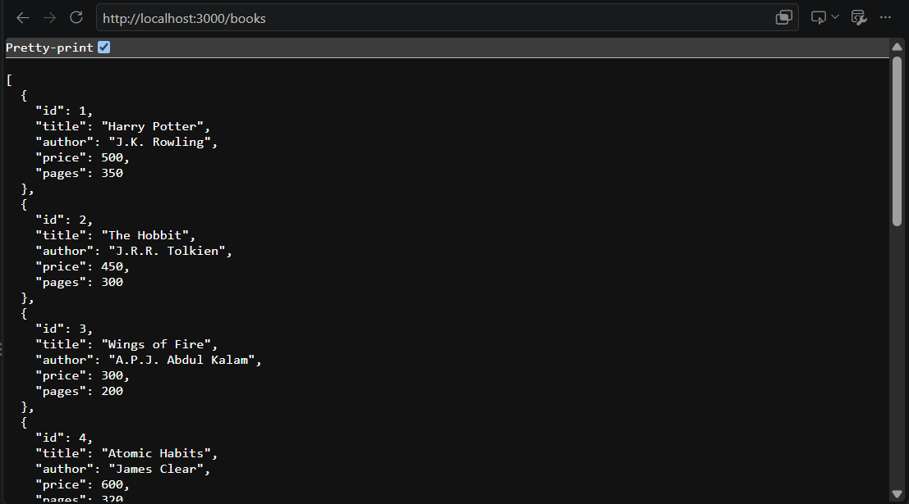
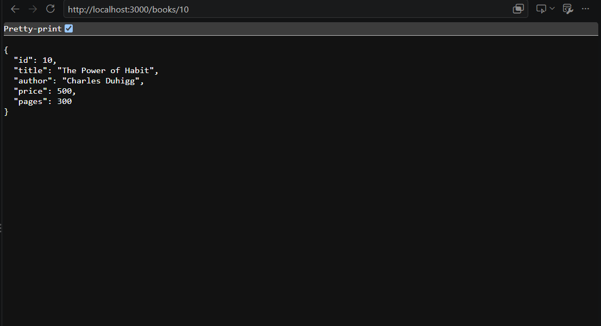
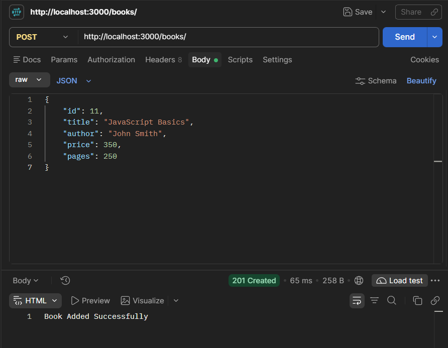
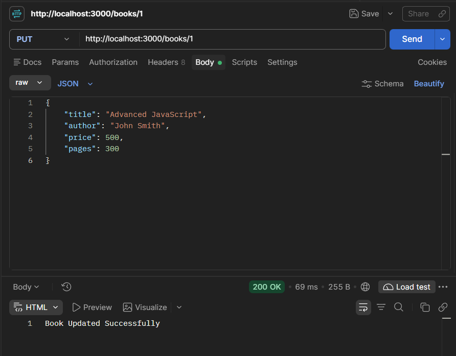
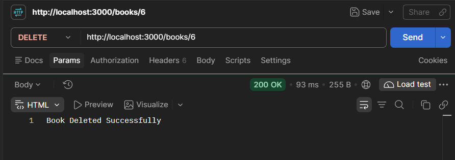

# Lab 2: SQLite Database and CRUD Routes

## Student Details

- **Name: P.Harsha Siddhartha
- **Registration Number:** 252U1R9122
- **Section:** CSE-GEN-AI 2B 111
- **Course:** Backend Development Fundamentals
- **Lab Number:** 02

## Live Link

**Deployment URL:** Not deployed yet.

## Objective

To connect a Node.js and Express server to an SQLite database and perform CRUD
(Create, Read, Update, Delete) operations through HTTP API routes. The project
demonstrates how to create a database, insert records, retrieve records, update
existing records, and delete records using parameterized SQL queries.

## Technologies Used

- Node.js
- Express.js
- SQLite
- sqlite3
- sqlite
- JavaScript
- npm
- Postman
- Visual Studio Code

## Project Structure

```text
lab-02/
├── screenshots/
│   ├── get-all-books.png
│   ├── get-book-10.png
│   ├── create-book.png
│   ├── update-book.png
│   └── delete-book.png
├── app.js
├── bookStore.db
├── package.json
├── package-lock.json
├── .gitignore
└── README.md
```

## Installation and Setup

### Prerequisites

- Node.js and npm installed
- Visual Studio Code or another code editor
- Postman installed
- Basic knowledge of SQL and JavaScript

### Steps to Run

1. Clone the repository or download the project.
2. Open the `lab-02` folder in the terminal.
3. Install the dependencies:

   ```sh
   npm install
   ```

4. Start the Express server using nodemon:

   ```sh
   npm run dev
   ```

   Alternatively, start the server without nodemon:

   ```sh
   npm start
   ```

5. The server will start at `http://localhost:3000/` by default. Set the
   `PORT` environment variable to use a different port.
6. Open Postman and test the CRUD API endpoints.

### Database Setup

The SQLite database file is named `bookStore.db`. On startup, the application
creates the database and `book` table if needed. If the table is empty, the app
inserts ten sample books. Existing records are preserved on later starts.

| Column | Data Type | Description |
| --- | --- | --- |
| `id` | INTEGER | Primary key with auto increment |
| `title` | TEXT | Book title |
| `author` | TEXT | Book author |
| `price` | INTEGER | Book price |
| `pages` | INTEGER | Number of pages |

## Endpoints

| Method | Endpoint | Description | Expected Status |
| --- | --- | --- | --- |
| GET | `/books/` | Retrieves all books from the database | 200 OK |
| GET | `/books/:bookId/` | Retrieves a particular book using its ID | 200 OK |
| POST | `/books/` | Adds a new book to the database | 201 Created |
| PUT | `/books/:bookId/` | Updates an existing book using its ID | 200 OK |
| DELETE | `/books/:bookId/` | Deletes a book using its ID | 200 OK |

If the requested book ID does not exist, the GET, PUT, and DELETE routes return
a `404 Not Found` response. POST and PUT require a non-empty `title` and
`author`, a non-negative integer `price`, and a positive integer `pages`;
invalid request data returns `400 Bad Request`.

Example request body for POST and PUT:

```json
{
  "title": "JavaScript Basics",
  "author": "John Smith",
  "price": 350,
  "pages": 250
}
```

## Screenshots

### 1. Get All Books

Displays all book records stored in the SQLite database.



### 2. Get Book By ID

Displays the details of a particular book using its ID.



### 3. Add a New Book (POST)

Adds a new book to the database by sending book details in JSON format through
Postman.



### 4. Update Book (PUT)

Updates the details of an existing book using its ID.



### 5. Delete Book (DELETE)

Deletes a particular book from the SQLite database using its ID.



## HTTP Status Codes

- **200 OK:** The request was successful.
- **201 Created:** A new book was successfully added to the database.
- **400 Bad Request:** The request contains invalid or missing book fields.
- **404 Not Found:** The requested book ID does not exist.

## Viva Questions

### 1. Why do we use `async/await` in database operations?

`async/await` is used to handle asynchronous database operations. It ensures
that the program waits for the database operation to complete before executing
the next statement.

### 2. What is SQL Injection and how do placeholders prevent it?

SQL Injection is a security attack in which malicious SQL commands are inserted
through user input. Parameterized queries using `?` placeholders help prevent
SQL injection by treating user input as data rather than executable SQL code.

### 3. When is PUT used instead of POST?

- **POST:** Used to insert a new record into the database.
- **PUT:** Used to update an existing record in the database.

## Problems Faced and Solutions

- Connected the Express server to the SQLite database using the `sqlite` and
  `sqlite3` packages.
- Used `async/await` to handle asynchronous database operations.
- Used parameterized SQL queries with `?` placeholders to prevent SQL
  injection.
- Tested all five CRUD endpoints using Postman.
- Verified that POST, PUT, and DELETE operations correctly modify the SQLite
  database.

## Git and Repository Notes

- The `.gitignore` file excludes `node_modules/` and `.env`.
- The `node_modules/` directory must not be committed.
- The SQLite database file `bookStore.db` is included in the project.
- Postman screenshots are stored in the `screenshots/` directory.
- All five CRUD endpoints are tested using Postman.
- The project is submitted through the course GitHub repository.
